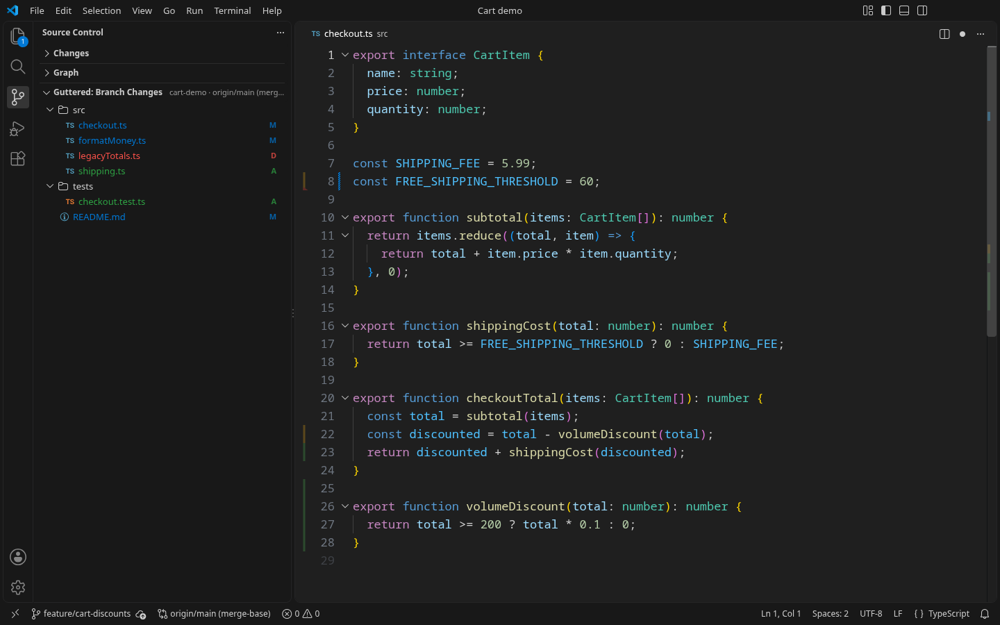
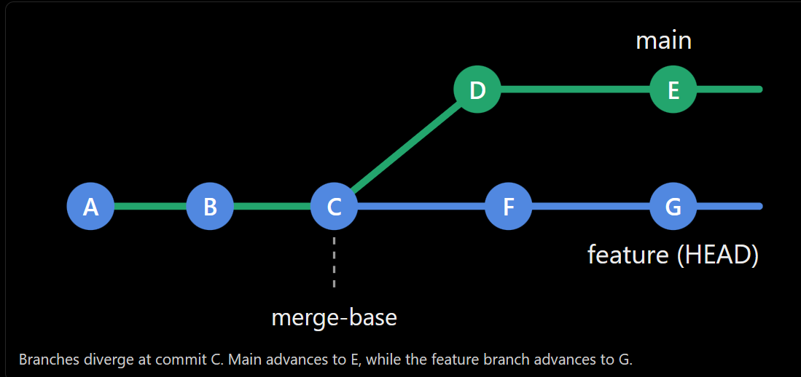
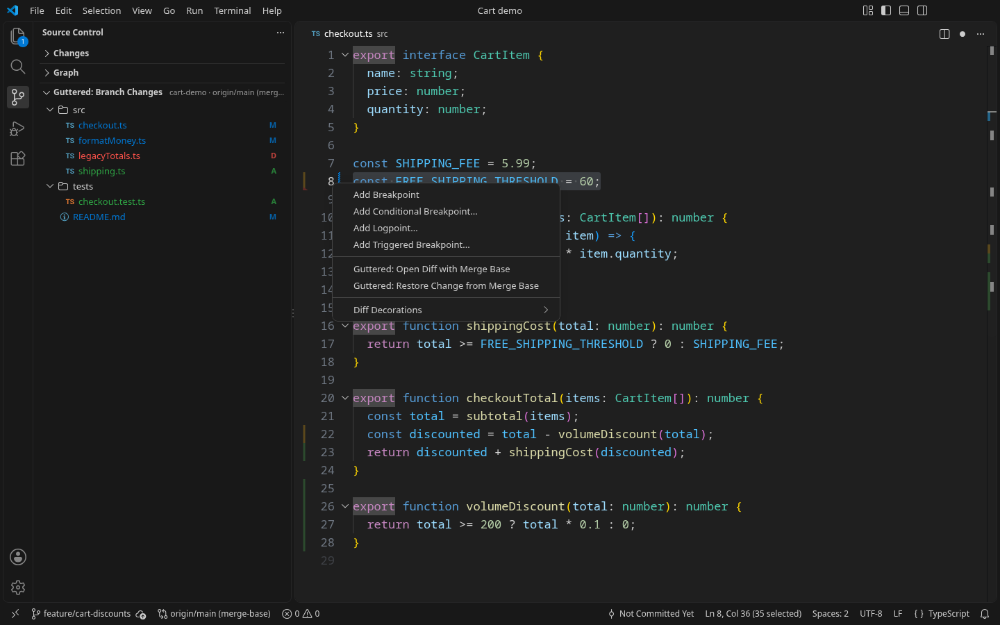
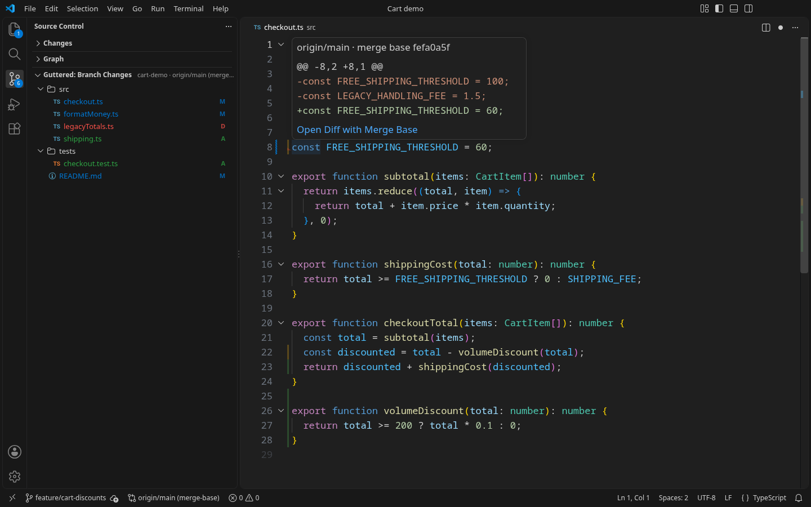
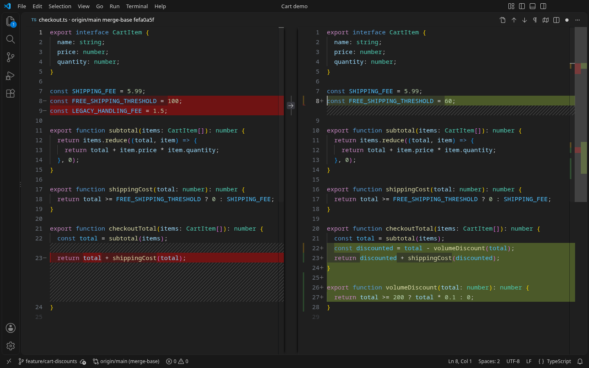
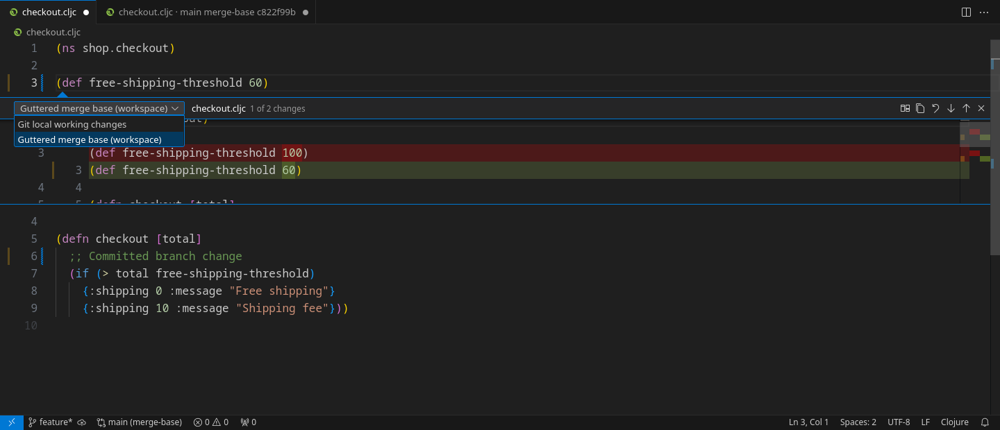

# Guttered


Guttered shows your branch's changes **since its merge base with the repository's default branch**, directly in the normal VS Code editor. Committed changes stay visible alongside staged, unstaged, and unsaved edits. New and untracked files that Git isn't ignoring are included.



*Committed branch changes and an unsaved edit, with markers in the default glyph margin and the changed-files tree in Source Control.* [View the light theme](assets/screenshots/branch-changes-light.png).

## Compare from where your branches diverged

A **merge base** is a common ancestor that Git selects for your branch and the comparison reference. Guttered detects the repository's default branch automatically and uses its merge base with `HEAD` as the baseline.



In this example, the default branch is `main`. The merge base is **C**, even though `main` has advanced to **E** and your feature branch is at **G**. Guttered compares the file at **C** with your **current editor contents**: the net changes from **F** and **G**, plus staged, unstaged, and unsaved edits. Changes made only in **D** and **E** stay out of the comparison.

Committing your work keeps its branch markers visible. If `main` advances again, the baseline stays at **C** while the branches still share that same ancestor. After a merge, rebase, or branch switch, Guttered recalculates the merge base to follow the new history.

VS Code's native Git markers show local changes relative to `HEAD` and the index. Guttered adds a view of the whole branch's net changes since the merge base, so you can keep track of work across multiple commits.

## Install

You need desktop VS Code, Git 2.30 or newer, and a trusted workspace. Guttered uses the Git executable found by VS Code's built-in Git extension. If that extension is disabled, it tries `git.path` (a path or a list of candidates), then Git on PATH. Reload the window after changing the Git executable.

The extension supports VS Code 1.95 and newer.

Install [Guttered from the Visual Studio Marketplace](https://marketplace.visualstudio.com/items?itemName=nathangerday.guttered), or search for `nathangerday.guttered` in VS Code's Extensions view. Open a file in a Git repository to start comparing automatically.

If you installed an earlier GitHub VSIX, uninstall that copy before installing the Marketplace version. The publisher ID changed from `guttered` to `nathangerday`, so VS Code treats them as separate extensions. Your `guttered.*` settings still apply.

To build the extension from this repository, use Node.js 22 or newer:

```sh
npm ci
npm run package
```

## Use Guttered

Added lines have soft green bars, modified lines have soft yellow bars, and deleted lines have soft red triangles on the neighboring line. Markers use 30% opacity by default, keeping native Git indicators more prominent on both dark and light themes. Markers sit in the glyph margin alongside breakpoints, so the text starts at its usual position. The overview ruler also shows the changes; text backgrounds stay unchanged. Right-click the line number or glyph margin of a marked line for Guttered's actions at that line.



*Open the merge-base diff or restore the clicked change from the same menu as VS Code's breakpoint actions.*

The glyph margin has trade-offs set by VS Code:

- Clicking the glyph margin of a changed line doesn't add a breakpoint. Right-click the gutter and choose **Add Breakpoint**, or press F9. Clicking an existing breakpoint still removes it.
- A breakpoint on a changed line needs a second glyph column, so the margin widens while it's set.
- Glyphs have no hover preview. Hover the changed code and click **Open change diff**, or use **Preview Change with Merge Base** from the gutter menu. VS Code's public extension API exposes neither hover nor left-click events for decoration glyphs. The optional [experimental workbench hook](#experimental-gutter-clicks) adds direct left-click support.
- Another extension's gutter icon on the same changed line, such as a bookmark, shares the marker's slot, and VS Code shows only one of them.
- Markers need **Editor: Glyph Margin**, which is on by default.

To keep breakpoint clicks free and preview changes on hover, set **Guttered: Gutter Placement** (`guttered.gutterPlacement`) to `inset`. Markers then sit in an 8 px inset before the text, leaving breakpoint clicks, line numbers, folding controls, and native Git markers available. Unchanged lines use the same inset to keep the code aligned.

The status bar shows the selected reference, such as `origin/trunk (merge-base)`. Hover for the current branch, merge-base SHA, and comparison state. Click it to open the actions menu.

Hover over the code on a changed line to reveal a compact **Open change diff** link alongside any language documentation. One click opens the selected diff view at that change, including unsaved edits. The action works with either marker placement and adds no permanent text or spacing. Disable it with **Guttered: Hover Action** (`guttered.hoverAction`).

With the inset placement, hover over a branch-change marker to preview the removed and added lines. Click **Open Diff with Merge Base** in the hover to open VS Code's diff view at that change, including unsaved edits. Large previews are shortened; the diff view shows the full comparison.



*The preview compares the original threshold of 100 with the unsaved value of 60 and shows the removed handling-fee line.*

Marker previews stay separate from code documentation. They require the inset placement, visible inlay hints, and **Editor: Inlay Hints: Padding** turned off (VS Code's defaults). If hints are hidden or padded, the markers and **Guttered: Open Diff with Merge Base** command still work.

**Guttered: Toggle On/Off** disables or enables Guttered across the current workspace. Turning it off removes markers and previews, clears the changed-files view, and stops comparison updates. The choice is remembered for that workspace; enabling Guttered again preserves your per-folder settings and unsaved edits.

The **Guttered: Branch Changes** section in Source Control lists changed files from the active file's repository, grouped under their parent folders. It uses the selected reference's merge base and includes committed, staged, unstaged, untracked, and unsaved changes. With no file selected, it uses the first workspace folder. Files use your file icon theme, with **A** (green), **M** (blue), and **D** (red) badges for added, modified, and deleted files. Badge colors follow your theme's Git gutter colors. Click a file to compare its read-only merge-base version on the left with the working file, including unsaved edits, on the right. Hover over a file row and click its **Open File** icon to open the working file directly. Added files have an empty left side; deleted files have an empty right side. Baseline loading keeps the existing text and size limits. Renames appear as a deletion and an addition, matching the gutter's path-based comparison.

The tree updates automatically while visible. It lists saved file changes through Git and applies open, unsaved buffers on top, so restoring a buffer to the baseline removes that file from the list. Binary and large files can appear in the tree even when their gutter comparison is unavailable. The view's toolbar offers toggle, reference selection, refresh, and diff-view selection. The Source Control icon keeps VS Code's normal count of local changes.

## Choose a diff view

**Preview Change with Merge Base** opens the selected diff view at the changed line. Run **Guttered: Select Diff View** from the Command Palette or the Branch Changes toolbar to choose either mode. The choice is saved for the current workspace folder, or in user settings for a file outside a workspace:

- **Native diff editor** (default) opens VS Code’s normal comparison editor. Both sides use the installed language grammars and theme, including Clojure. The original follows the working file’s language mode, including manual language selections. Use VS Code’s Diff View menu for inline or side-by-side comparison, its next/previous arrows for navigation, and **Revert Block** or **Revert Selection** for undoable buffer edits. Layout choices follow VS Code’s shared diff settings. Guttered adds **Copy Change Patch** and **Open Working File** to the editor toolbar; Copy uses the hunk at the cursor. Semantic highlighting on the read-only original depends on whether the language extension supports virtual documents.
- **Inline Quick Diff (Experimental)** adds a **Guttered merge base** provider and clickable markers in VS Code’s native change-indicator gutter. Click a native marker, or use the changed-code hover or optional glyph hook, to open its compact inline preview. The base selector retains Git’s normal comparison alongside Guttered; select **Guttered merge base** if Git opens first at an overlapping change. Guttered’s **Revert Change**, **Copy Patch**, and **Full Diff** buttons appear only for its own baseline. Revert restores the complete displayed native block, supports normal Undo, and neither saves nor stages. Next/previous buttons and syntax highlighting are native.



*The merge base is on the left; the current buffer is on the right. Clojure highlighting comes from VS Code, using the installed grammar and theme.*



*Quick Diff keeps the preview inside the file. Its selector lets you compare with either **Guttered merge base** or **Git Local Changes**.*

When a hover action or injected glyph click opens Quick Diff, VS Code may initially choose **Git Local Changes**. Select **Guttered merge base**, followed by your repository’s name, in the dropdown at the top of the preview to see the branch comparison. The command that opens this preview has no supported parameter for forcing a provider. The native diff editor always opens Guttered’s merge-base comparison directly.

Quick Diff uses the editor’s SCM decoration settings and colors. It shares Git’s indicator lane, while Guttered’s existing glyph/inset markers keep their own appearance. Its Source Control entry lists changes in open compared files; the Branch Changes tree continues to list the whole branch. Choosing Native diff editor removes the extra provider. Clicking a native gutter indicator opens the supported SCM preview directly. Quick Diff is inline only; **Full Diff** offers both layouts. If `scm.diffDecorations` is `"none"`, **Preview Change** opens the full diff instead and explains how to enable the inline preview.

Version 0.7.0 replaces the previous custom diff panel. Both new modes use installed language grammars, file associations, the working file’s language mode, and editor token-color customizations. They work with `.clj`, `.cljc`, `.cljs`, and other languages supported by the installed VS Code extensions. Semantic highlighting on a virtual original still depends on the language extension. Reload VS Code after upgrading so the new commands and settings are registered.

## Comparison actions

A *hunk* is a group of adjacent changed lines. Alongside the diff-view actions above, the available actions are:

- **Toggle On/Off** pauses or resumes Guttered for this workspace. The status bar menu labels the action **Disable Guttered** or **Enable Guttered**.
- **Show Changed Files** opens the branch-changes tree in Source Control.
- **Open Diff with Merge Base** compares the merge-base version with your current editor contents, including unsaved edits.
- **Go to Next/Previous Change** moves between hunks, wrapping at either end of the file.
- **Restore Change from Merge Base** restores the hunk at the cursor, or at the line you right-clicked in the gutter. Put the cursor on a line with a deletion triangle to bring deleted lines back. Restoration edits the buffer and supports normal **Undo**; it does not save or stage. It can reverse committed branch changes in your working file.
- **Change Base Reference** lists local and remote-tracking branches from the file's repository. Type to filter them, or choose **Default branch (automatic)** at the top to return to the default branch. **Enter another Git reference…** accepts a tag, commit, or other reference. Every choice compares from its merge base with HEAD.
- **Refresh Comparison** checks again and clears cached failures. Normal operation is automatic.

All actions appear in the Command Palette and status bar menu. The **Guttered** editor context menu contains preview, diff, navigation, and restore. Right-click the line number or glyph margin of a changed line for **Preview Change with Merge Base**, **Open Diff with Merge Base**, and **Restore Change from Merge Base** at that line, below VS Code's breakpoint actions. You can assign shortcuts in VS Code's Keyboard Shortcuts editor; Guttered doesn't install default bindings.

Base-reference overrides apply to the current workspace folder, so repositories nested in that folder share the override. For a file outside every workspace folder, the command updates user settings and affects all workspaces. The picker states which scope it will change. It lists branches already available locally; it does not fetch.

## Experimental gutter clicks

For the selected diff view with one click directly on the glyph marker, run **Guttered: Enable Gutter Clicks (Experimental)** in the Command Palette, then choose **Reload Window**. This option is off by default. It requires a writable desktop VS Code installation. Local workspaces need only Guttered. For **Windows VS Code connected to WSL**, enable the hook in a local Windows window first, then open WSL with the matching Guttered version installed there. An already-installed hook connects directly to the remote extension; the companion is optional. To install or restore the Windows hook from inside WSL, install [**Guttered Remote/WSL Helper**](https://marketplace.visualstudio.com/items?itemName=nathangerday.guttered-workbench) locally on Windows. The same routing supports desktop SSH and container workspaces; browser-hosted VS Code is unsupported.

**Status** works from WSL in either setup. With the companion installed locally, **Enable** and **Disable/Restore** also work from the WSL window: the companion handles the Windows installation while comparisons and diff commands stay in WSL. Without it, run the installation or restore commands in a local Windows window. The injection setting belongs to the desktop client, applies across its local and remote windows, and is excluded from Settings Sync by default. Guttered and the companion must contain the same hook revision; Guttered reports mismatched versions instead of connecting.

The command appends a small hook to the desktop client's workbench JavaScript and saves a verified backup beside that file. It uses VS Code's internal editor and command services to identify the clicked file, line, and document version. In a remote window, it sends URI objects through VS Code's command/RPC routing so VS Code translates remote authorities and paths for the workspace host. Each workspace activation gets its own session, and stale sessions or document versions are rejected. It opens no local server and does not relax the workbench's Content Security Policy. Only ordinary left clicks on a Guttered glyph are handled. Right clicks, modifier clicks, line numbers, native Git indicators, and breakpoints retain their normal behavior. If another glyph shares the same slot, its native action takes priority. The inset placement continues to use its existing hover action.

This uses unsupported workbench internals. VS Code may show an installation-integrity warning, and application updates or Guttered hook changes may require running **Enable Gutter Clicks** again and reloading. Guttered never patches an update automatically. **Guttered: Gutter Clicks Status** reports whether the hook is active in the current window. Other already-open windows need reloading after installation or restoration.

Run **Guttered: Disable Gutter Clicks and Restore Workbench** before uninstalling Guttered or its local companion. It stops click handling immediately, removes only Guttered's verified hook, and offers a reload. An application update is preserved rather than overwritten with the previous backup. If another tool changed the hook itself or damaged its recovery files, restoration stops and reports the backup path in **Output → Guttered Gutter Clicks**. Setting `guttered.workbenchInjection` to `false` also stops handling immediately, but keeps the installed file patch until you run the restore command.

## How comparison works

Guttered identifies the repository containing each visible file. It reads `origin/HEAD` to find the default branch, using the first remote when there is no `origin`. If the symbolic reference is missing, `git ls-remote --symref` contacts the remote to ask for its default branch. Both successful and failed remote lookups are cached for five minutes; **Refresh Comparison** clears that cache. If the remote-tracking branch is unavailable, Guttered tries the corresponding local branch.

The baseline is `git merge-base HEAD <base-reference>`. Guttered reads the file at that commit with `git show` and calculates a line diff against the live editor buffer. This includes unsaved edits and keeps the comparison tied to the common ancestor as the default branch advances.

Typing updates the indicators after a 250 ms pause by default. Git events and a three-second poll handle branch switches, rebases, merges, resets, fetches, changes to ignore rules, and new nested repositories. Polling pauses while the VS Code window is in the background and resumes when it gains focus. Only visible documents receive line comparisons; the changed-files tree also includes unsaved buffers from other open documents. Cached baselines, diffs, and saved-file lists avoid repeated work while typing. A hidden tree does not scan the repository.

Guttered's Git operations are read-only. It never fetches, changes refs, stages files, or changes Git configuration.

## Settings

Settings support workspace-folder overrides except `guttered.workbenchInjection`, which belongs to the desktop client and applies across its windows.

| Setting | Default | Purpose |
| --- | --- | --- |
| `guttered.enabled` | `true` | Enable continuous comparisons |
| `guttered.baseReference` | `""` | Detect the remote default branch; optionally use an explicit reference |
| `guttered.debounceMs` | `250` | Delay after typing, in milliseconds |
| `guttered.maxFileSizeKB` | `1024` | Maximum size of either file, in KiB |
| `guttered.gutter` | `true` | Show markers beside the code |
| `guttered.workbenchInjection` | `false` | Experimental glyph clicks; install/restore with the dedicated commands |
| `guttered.diffView` | `"native"` | Native diff editor or experimental `"quickDiff"` inline preview |
| `guttered.hoverAction` | `true` | Show a one-click diff-view action when hovering over changed code |
| `guttered.gutterPlacement` | `glyphMargin` | Place markers in the glyph margin, or in an `inset` before the text |
| `guttered.overviewRuler` | `true` | Show overview ruler markers |
| `guttered.opacity` | `0.3` | Marker opacity, from invisible (`0`) to fully opaque (`1`) |
| `guttered.colors.added` | `#4CAF50` | Added line color |
| `guttered.colors.modified` | `#E6A817` | Modified line color |
| `guttered.colors.deleted` | `#F44336` | Deletion marker color |

## Troubleshooting and limits

When a comparison is unavailable, hover over the status item or open **Output → Guttered** for the reason. A repository needs an existing commit and a locally available base reference with shared history. Repositories without a remote need an explicit **Base Reference** setting. A missing branch may need fetching, and shallow or unrelated history may need more history or another base.

If default-branch detection cannot reach the remote, restore network or authentication access and run **Guttered: Refresh Comparison**. You can also set **Base Reference** to a locally available branch and compare offline. To record the remote's default branch in Git, run `git remote set-head origin --auto` once access is restored, replacing `origin` if your remote has another name.

VS Code's native Git bars compare against HEAD and the index, so they can appear alongside Guttered's branch comparison with different markers. Use `scm.diffDecorations` to control the native bars and Quick Diff previews. Setting it to `"none"` leaves Guttered's glyph/inset markers available, but hides its native Quick Diff indicators and inline preview.

- Comparisons use file paths. A renamed file with no matching path in the baseline appears entirely added.
- Ignored files without a baseline are skipped. A file explicitly added to Git, including with `git add -f`, is still compared. Git metadata has no indicators, including the `.git` pointer files used by worktrees and submodules.
- Empty new files have no lines to mark. Deletions use the neighboring line, including when they occur at the beginning or end of a file.
- CRLF/LF differences are normalized; changes to whitespace and the final newline remain visible.
- Baselines must be valid UTF-8 text. Invalid UTF-8, binary files, and baseline symlinks are skipped; Restore is unavailable for these files. Untitled buffers need a file path before their repository can be identified.
- Baselines contain the stored Git blob. Git LFS and other content filters aren't applied, so a filtered file can produce misleading differences against its expanded editor contents.
- Files over the configured size threshold or 50,000 lines are skipped. The diff algorithm has a 100 ms timeout; reading files, splitting lines, and applying decorations occur outside that limit. Diff timeouts are cached until the document, baseline, or configuration changes, or you request a refresh.
- Only file contents are compared. File permissions and deleted files without an open editor have no gutter representation.

## Development

Desktop tests have passed on VS Code 1.95.3 and 1.141.0, including a separate run with built-in Git disabled.

After `npm ci`, press **F5** to launch an Extension Development Host.

```sh
npm run check                 # Strict TypeScript validation
npm test                      # Diff, controller, and real Git repository tests
npm run test:integration       # Desktop extension-host tests; downloads VS Code
GUTTERED_TEST_NO_GIT=1 npm run test:integration   # Tests the fallback with built-in Git disabled
npm run package               # Build the main Guttered VSIX
npm run package:workbench     # Build the optional UI companion VSIX
```

Desktop tests require a graphical session that can focus the test window. Headless Linux needs Xvfb and a window manager. Set `VSCODE_VERSION` to select a release, for example `VSCODE_VERSION=1.95.3 npm run test:integration`. The tests use temporary repositories and user data and remove them afterward. Prefix environment variables as shown in a POSIX shell; in PowerShell, set them with `$env:NAME = 'value'` before running the command.

The source files follow the work the extension performs: `git.ts` handles Git and its caches, `diff.ts` computes changes and restoration edits, `decorations.ts` draws markers, `hover.ts` previews individual changes, `nativeDiff.ts` opens native diff editors, `quickDiff.ts` provides the native inline preview, `files.ts` combines saved and unsaved file changes and builds their folder tree, `changedFiles.ts` manages the sidebar, `controller.ts` coordinates updates, `extension.ts` registers commands, and `config.ts` reads settings. The baseline cache is limited to 16 MiB and 256 entries. The bundled `diff` dependency computes changes; the build includes its third-party notices. VS Code supplies syntax highlighting through the user's installed language extensions and theme.

Transparent PNGs are available at 1254×1254 (`assets/logo.png`), 256×256 (`assets/icon.png`), and 128×128 (`assets/icon-128.png`). The VSIX includes only `assets/icon.png`.

## Publishing

On the machine that will publish releases, authenticate once with the Microsoft account that owns the publisher. Create an Azure DevOps personal access token with **Organization: All accessible organizations** and **Custom defined → Show all scopes → Marketplace → Manage**. Follow the [VS Code publishing guide](https://code.visualstudio.com/api/working-with-extensions/publishing-extension#get-a-personal-access-token).

```sh
npx vsce login nathangerday
npx vsce verify-pat nathangerday
```

Paste the token into the masked login prompt. VSCE saves the credential outside this repository. Microsoft retires global personal access tokens on December 1, 2026; after that, use the guide's Microsoft Entra authentication workflow and pass `--azure-credential` to the publish command.

For a new release, give the main extension and companion the same version, update both changelogs and documentation, run the tests, and commit the release changes before publishing. For example:

```sh
release_version=0.7.2 # Replace with the next unpublished version.
npm version "$release_version" --no-git-tag-version
npm --prefix workbench-extension version "$release_version" --no-git-tag-version
npm run check
npm test
npm run test:integration
npm run package
npm run package:workbench
# Review the VSIXs, then commit and tag the release before publishing.
npx vsce publish --packagePath "guttered-$release_version.vsix"
(cd workbench-extension && ../node_modules/.bin/vsce publish --packagePath "guttered-workbench-$release_version.vsix")
```

Packaging checks TypeScript and builds both extensions. Publishing with `--packagePath` uploads the exact reviewed VSIX without rebuilding. Publish both packages, then attach those same VSIXs and their SHA-256 checksums to a GitHub release for the version tag. Every release needs a version that has not already been published. The main and helper workbench payloads must be byte-identical; `cmp dist/workbench.js workbench-extension/dist/workbench.js` checks this.
