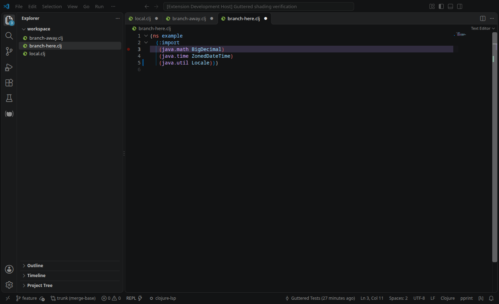
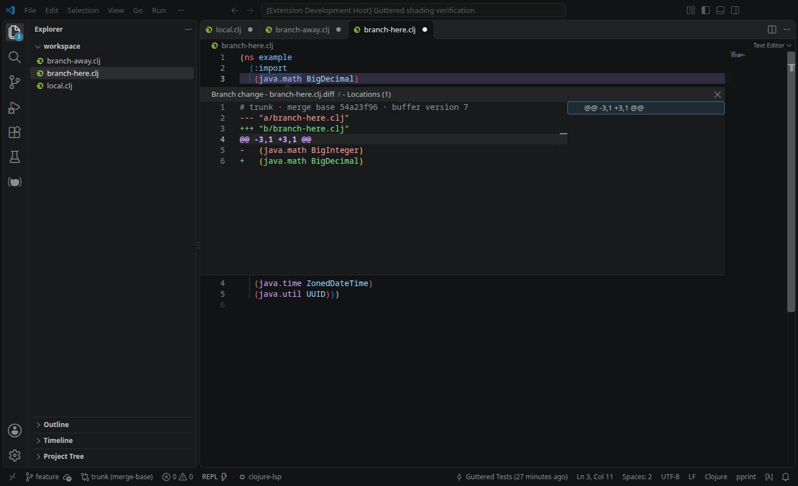

# Guttered


Guttered shows your branch's changes **since its merge base with the repository's default branch**, directly in the normal VS Code editor. Committed changes get violet shading; local edits keep VS Code’s native Git gutter bars. The full comparison includes staged, unstaged, and unsaved edits. New and untracked files that Git isn't ignoring are included.



*Violet committed branch changes alongside a native Git bar for a local edit.*

## Compare from where your branches diverged

A **merge base** is a common ancestor that Git selects for your branch and the comparison reference. Guttered detects the repository's default branch automatically and uses its merge base with `HEAD` as the baseline.


In this example, the default branch is `main`. The merge base is **C**, even though `main` has advanced to **E** and your feature branch is at **G**. Guttered compares the file at **C** with your **current editor contents**: the net changes from **F** and **G**, plus staged, unstaged, and unsaved edits. Changes made only in **D** and **E** stay out of the comparison.

Committing your work keeps its branch markers visible. If `main` advances again, the baseline stays at **C** while the branches still share that same ancestor. After a merge, rebase, or branch switch, Guttered recalculates the merge base to follow the new history.

VS Code's native Git markers show local changes relative to `HEAD` and the index. Guttered adds a view of the whole branch's net changes since the merge base, so you can keep track of work across multiple commits.

## Install

You need desktop VS Code, Git 2.30 or newer, and a trusted workspace. Guttered uses the Git executable found by VS Code's built-in Git extension. If that extension is disabled, it tries `git.path` (a path or a list of candidates), then Git on PATH. Reload the window after changing the Git executable.

The extension supports VS Code 1.100 and newer, including native Git indicators for staged changes.

Install [Guttered from the Visual Studio Marketplace](https://marketplace.visualstudio.com/items?itemName=nathangerday.guttered), or search for `nathangerday.guttered` in VS Code's Extensions view. Open a file in a Git repository to start comparing automatically.

If you installed an earlier GitHub VSIX, uninstall that copy before installing the Marketplace version. The publisher ID changed from `guttered` to `nathangerday`, so VS Code treats them as separate extensions. Your `guttered.*` settings still apply.

To build the extension from this repository, use Node.js 22 or newer:

```sh
npm ci
npm run package
```

## Use Guttered

Two different visual forms make the scope clear at a glance:

- **Local edits:** VS Code’s normal colored Git gutter bars, using your theme’s Git colors.
- **Committed branch changes:** a subdued violet background across the line, with dashed violet boundaries for deleted lines. Lines with local edits have no branch shading.

Branch shading uses 12% opacity by default. It adds no text, inset, gutter icon, or inlay hint, so source alignment, wrapping, indentation guides, breakpoint clicks, and documentation hovers stay intact. Violet overview markers appear in the right-hand lane. Native Git markers remain controlled by VS Code’s SCM settings.

The status bar shows the selected reference, such as `origin/trunk (merge-base)`. Hover for the current branch, merge-base SHA, and comparison state. Click it to open the actions menu.

Place the cursor on a changed line and press **Ctrl+K, Ctrl+Alt+D** (**Cmd+K, Cmd+Alt+D** on macOS), or choose **Guttered → Peek Change** in the editor context menu. A read-only, syntax-colored diff opens immediately below the source line. Press **Escape** to close it. This works for committed and local changes without sharing the source documentation hover. The native peek includes a locations list and can be resized.



Previews are snapshots of the buffer when opened. Large previews are shortened; **Open Diff with Merge Base** shows the full comparison, including unsaved edits.

**Guttered: Toggle On/Off** disables or enables Guttered across the current workspace. Turning it off removes markers, clears the changed-files view, and stops comparison updates and new previews. Already-open preview snapshots remain readable until closed. The choice is remembered for that workspace; enabling Guttered again preserves your per-folder settings and unsaved edits.

The **Guttered: Branch Changes** section in Source Control lists changed files from the active file's repository, grouped under their parent folders. It uses the selected reference's merge base and includes committed, staged, unstaged, untracked, and unsaved changes. With no file selected, it uses the first workspace folder. Files use your file icon theme, with **A** (green), **M** (blue), and **D** (red) badges for added, modified, and deleted files. Badge colors follow your theme's Git gutter colors. Click a file to compare its read-only merge-base version on the left with the working file, including unsaved edits, on the right. Added files have an empty left side; deleted files have an empty right side. Baseline loading keeps the existing text and size limits. Renames appear as a deletion and an addition, matching the path-based comparison.

The tree updates automatically while visible. It lists saved file changes through Git and applies open, unsaved buffers on top, so restoring a buffer to the baseline removes that file from the list. Binary and large files can appear in the tree even when their gutter comparison is unavailable. The view's toolbar offers toggle, reference selection, and refresh. The Source Control icon keeps VS Code's normal count of local changes.

A *hunk* is a group of adjacent changed lines. The available actions are:

- **Toggle On/Off** pauses or resumes Guttered for this workspace. The status bar menu labels the action **Disable Guttered** or **Enable Guttered**.
- **Show Changed Files** opens the branch-changes tree in Source Control.
- **Peek Change** opens a read-only unified diff beneath the current line.
- **Open Diff with Merge Base** compares the merge-base version with your current editor contents, including unsaved edits.
- **Go to Next/Previous Change** moves between hunks, wrapping at either end of the file.
- **Restore Change from Merge Base** restores the hunk at the cursor. Put the cursor on a line beside a dashed deletion boundary to bring deleted lines back. Restoration edits the buffer and supports normal **Undo**; it does not save or stage. It can reverse committed branch changes in your working file.
- **Change Base Reference** lists local and remote-tracking branches from the file's repository. Type to filter them, or choose **Default branch (automatic)** at the top to return to the default branch. **Enter another Git reference…** accepts a tag, commit, or other reference. Every choice compares from its merge base with HEAD.
- **Refresh Comparison** checks again and clears cached failures. Normal operation is automatic.

All actions appear in the Command Palette and status bar menu. The **Guttered** editor context menu contains peek, full diff, navigation, and restore. You can change the peek shortcut or assign other shortcuts in VS Code’s Keyboard Shortcuts editor.

Base-reference overrides apply to the current workspace folder, so repositories nested in that folder share the override. For a file outside every workspace folder, the command updates user settings and affects all workspaces. The picker states which scope it will change. It lists branches already available locally; it does not fetch.

## How comparison works

Guttered identifies the repository containing each visible file. It reads `origin/HEAD` to find the default branch, using the first remote when there is no `origin`. If the symbolic reference is missing, `git ls-remote --symref` contacts the remote to ask for its default branch. Both successful and failed remote lookups are cached for five minutes; **Refresh Comparison** clears that cache. If the remote-tracking branch is unavailable, Guttered tries the corresponding local branch.

The baseline is `git merge-base HEAD <base-reference>`. Guttered reads the immutable file blob and calculates a line diff against the live editor buffer. This includes unsaved edits and keeps the comparison tied to the common ancestor as the default branch advances.

Separate comparisons with HEAD and the Git index exclude local edits from branch shading, including staged edits reversed in the working tree. Tree, previews, navigation, and restoration retain the complete merge-base comparison.

Typing updates the indicators after a 250 ms pause by default. Git events and a three-second poll handle branch switches, rebases, merges, resets, fetches, changes to ignore rules, and new nested repositories. Polling pauses while the VS Code window is in the background and resumes when it gains focus. Only visible documents receive line comparisons; the changed-files tree also includes unsaved buffers from other open documents. Cached baselines, diffs, and saved-file lists avoid repeated work while typing. A hidden tree does not scan the repository.

Guttered's Git operations are read-only. It never fetches, changes refs, stages files, or changes Git configuration.

## Settings

All settings support workspace-folder overrides.

| Setting | Default | Purpose |
| --- | --- | --- |
| `guttered.enabled` | `true` | Enable continuous comparisons |
| `guttered.baseReference` | `""` | Detect the remote default branch; optionally use an explicit reference |
| `guttered.debounceMs` | `250` | Delay after typing, in milliseconds |
| `guttered.maxFileSizeKB` | `1024` | Maximum size of either file, in KiB |
| `guttered.gutter` | `true` | Show committed branch line shading and deletion boundaries |
| `guttered.overviewRuler` | `true` | Show overview ruler markers |
| `guttered.opacity` | `0.3` | Branch intensity; line shading uses 40% of this value |
| `guttered.colors.branch` | `#8B5CF6` | Violet branch indicator color |

## Troubleshooting and limits

When a comparison is unavailable, hover over the status item or open **Output → Guttered** for the reason. A repository needs an existing commit and a locally available base reference with shared history. Repositories without a remote need an explicit **Base Reference** setting. A missing branch may need fetching, and shallow or unrelated history may need more history or another base.

If default-branch detection cannot reach the remote, restore network or authentication access and run **Guttered: Refresh Comparison**. You can also set **Base Reference** to a locally available branch and compare offline. To record the remote's default branch in Git, run `git remote set-head origin --auto` once access is restored, replacing `origin` if your remote has another name.

Local indicators require VS Code’s built-in Git extension and enabled SCM diff decorations. Guttered does not replace these indicators when native Git is disabled. Setting `scm.diffDecorations` to `"none"` hides local bars while branch shading and the complete comparison remain available.

The former `guttered.colors.added`, `modified`, and `deleted` settings are replaced by `guttered.colors.branch`; branch indicators intentionally use one color distinct from native local Git markers.

- Comparisons use file paths. A renamed file with no matching path in the baseline appears entirely added.
- Ignored files without a baseline are skipped. A file explicitly added to Git, including with `git add -f`, is still compared. Git metadata has no indicators, including the `.git` pointer files used by worktrees and submodules.
- Empty new files have no lines to mark. Deletions use the neighboring line, including when they occur at the beginning or end of a file.
- CRLF/LF differences are normalized; changes to whitespace and the final newline remain visible.
- Baselines must be valid UTF-8 text. Invalid UTF-8, binary files, and baseline symlinks are skipped; Restore is unavailable for these files. Untitled buffers need a file path before their repository can be identified.
- Baselines contain the stored Git blob. Git LFS and other content filters aren't applied, so a filtered file can produce misleading differences against its expanded editor contents.
- Files over the configured size threshold or 50,000 lines are skipped. The diff algorithm has a 100 ms timeout; reading files, splitting lines, and applying decorations occur outside that limit. Diff timeouts are cached until the document, baseline, or configuration changes, or you request a refresh.
- Only file contents are compared. File permissions and deleted files without an open editor have no gutter representation.

## Development

Renderer checks target VS Code 1.141.0 with Calva enabled. Native local indicators require built-in Git; comparisons and commands also work with Git disabled.

After `npm ci`, press **F5** to launch an Extension Development Host.

```sh
npm run check                 # Strict TypeScript validation
npm test                      # Diff, controller, and real Git repository tests
npm run test:integration       # Desktop extension-host tests; downloads VS Code
GUTTERED_TEST_NO_GIT=1 npm run test:integration   # Tests the fallback with built-in Git disabled
npm run package               # Build the VSIX
```

Desktop tests require a graphical session that can focus the test window. Headless Linux needs Xvfb and a window manager. Set `VSCODE_VERSION` to select a release, for example `VSCODE_VERSION=1.100.0 npm run test:integration`. The tests use temporary repositories and user data and remove them afterward. Prefix environment variables as shown in a POSIX shell; in PowerShell, set them with `$env:NAME = 'value'` before running the command.

The source files follow the work the extension performs: `git.ts` handles Git and its caches, `diff.ts` computes changes and restoration edits, `decorations.ts` draws markers, `peek.ts` supplies read-only inline diff snapshots, `files.ts` combines saved and unsaved file changes and builds their folder tree, `changedFiles.ts` manages the sidebar, `controller.ts` coordinates updates, `extension.ts` registers commands, and `config.ts` reads settings. The baseline cache is limited to 16 MiB and 256 entries. `diff` is the only runtime dependency and is bundled in the VSIX.

Transparent PNGs are available at 1254×1254 (`assets/logo.png`), 256×256 (`assets/icon.png`), and 128×128 (`assets/icon-128.png`). The VSIX includes only `assets/icon.png`.

## Publishing

On the machine that will publish releases, authenticate once with the Microsoft account that owns the publisher. Create an Azure DevOps personal access token with **Organization: All accessible organizations** and **Custom defined → Show all scopes → Marketplace → Manage**. Follow the [VS Code publishing guide](https://code.visualstudio.com/api/working-with-extensions/publishing-extension#get-a-personal-access-token).

```sh
npx vsce login nathangerday
npx vsce verify-pat nathangerday
```

Paste the token into the masked login prompt. VSCE saves the credential outside this repository. Microsoft retires global personal access tokens on December 1, 2026; after that, use the guide's Microsoft Entra authentication workflow and pass `--azure-credential` to the publish command.

For a new release, choose its version, update the changelog, run the tests, and commit the release changes before publishing. For example, to prepare the next patch version:

```sh
npm version patch --no-git-tag-version
# Update CHANGELOG.md, test, and commit before the next command.
npm run publish:marketplace
```

The publish command checks TypeScript, builds the extension, and uploads it to the Marketplace. Every release needs a version that has not already been published.
